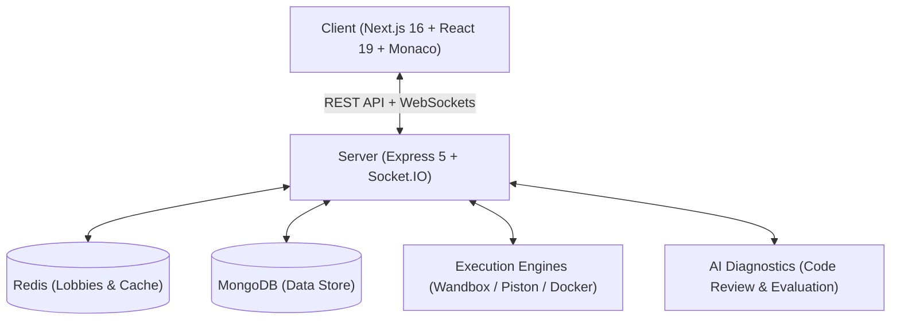

# CodeCampus 🔥

> A next-generation competitive programming and proctored technical assessment platform featuring dual-mode contest environments, real-time 1v1 Versus battles, AI-powered mistake diagnostics, role-based portals (Student, Instructor, Admin), a standalone multi-file IDE with interactive terminal, and GitHub-style developer streak tracking.

---

## 📑 Table of Contents

- [✨ Core Features](#-core-features)
  - [🏆 Dual-Mode Contests & Proctored Assessments](#-dual-mode-contests--proctored-assessments)
  - [🤖 AI Code Review & Mistake Diagnostics](#-ai-code-review--mistake-diagnostics)
  - [⚔️ Real-Time 1v1 Versus Battles](#️-real-time-1v1-versus-battles)
  - [💻 Standalone Online IDE & Terminal](#-standalone-online-ide--terminal)
  - [👥 Role-Based Portals & Dashboards](#-role-based-portals--dashboards)
  - [🏋️ Algorithmic Challenge Library](#️-algorithmic-challenge-library)
  - [🏅 Developer Profiles & Streak Heatmap](#-developer-profiles--streak-heatmap)
  - [🛡️ Anti-Cheating & Security Suite](#️-anti-cheating--security-suite)
- [🛠️ Tech Stack](#️-tech-stack)
- [📁 Project Structure](#-project-structure)
- [🚀 Quick Start](#-quick-start)
  - [Prerequisites](#prerequisites)
  - [1. Launch Database & Cache](#1-launch-database--cache)
  - [2. Environment Configuration](#2-environment-configuration)
  - [3. Install Dependencies & Seed Database](#3-install-dependencies--seed-database)
  - [4. Start Backend Server](#4-start-backend-server)
  - [5. Start Frontend Client](#5-start-frontend-client)
  - [Demo Test Accounts](#demo-test-accounts)
- [📡 API Reference](#-api-reference)
- [⚔️ Socket.IO Events](#️-socketio-events)
- [💻 Supported Compilers & Runtimes](#-supported-compilers--runtimes)
- [🏗️ Production Deployment](#️-production-deployment)
- [📄 License](#-license)

---

## ✨ Core Features

### 🏆 Dual-Mode Contests & Proctored Assessments

CodeCampus provides two distinct evaluation modes tailored for academic examinations, hiring assessments, and competitive tournaments:

1. **Standard Algorithmic Qualifier (Mode 1 — Strict Examination)**:
   - **Blank Plain-Text / Code Editor**: Zero pre-submission code execution to simulate strict pen-and-paper or raw-logic coding exams.
   - **Non-Selectable Problem Panes**: Statements, constraints, and examples cannot be highlighted, inspected, or copied.
   - **One-Shot Evaluation**: Solutions are graded against both public and hidden test cases upon final submission, with instant score calculation and AI performance evaluation.

2. **Interactive Assessment (Mode 2 — SuperSet Style)**:
   - **Multi-Section Exams**: Combines algorithmic coding challenges with conceptual Multiple-Choice Questions (MCQs).
   - **Live Test Runner Drawer**: Run code against sample test cases in real-time with granular stdout, stderr, and execution timing metrics.
   - **VS Code Split-Pane Interface**: Resizable editor and terminal panels, breadcrumbs, language file icons, and status bar displaying cursor position, spaces, encoding, and active language.

3. **Anti-Cheating Telemetry & Proctoring Engine**:
   - **Fullscreen Enforcement**: Detects fullscreen exits with automated warning banners.
   - **Tab-Switch & Blur Tracking**: Logs background tab changes and window defocus events in real time.
   - **Copy-Paste Blocker**: Intercepts `Ctrl+V` / `Cmd+V`, context menus, and drag-and-drop operations on editor surfaces.
   - **Proctoring Incident Telemetry**: All violations are reported to the server and attached to the submission report for instructor review.

---

### 🤖 AI Code Review & Mistake Diagnostics

Upon completing any contest assessment or problem submission, CodeCampus passes the telemetry and code solutions through an AI Evaluation pipeline:
- **Algorithmic Bottleneck Detection**: Identifies asymptotic inefficiencies in time and space complexity ($O(N^2)$ vs. $O(N \log N)$).
- **Edge-Case Failure Analysis**: Explains why edge test cases failed (off-by-one errors, empty arrays, integer overflows, recursion limits).
- **Actionable Hints & Fixes**: Delivers structured feedback on how to refactor without giving away direct answers.
- **Mistake Categorization**: Tags mistakes by concept (e.g., *Dynamic Programming Transitions*, *Hash Collision Handling*, *Two-Pointer Invariants*).

---

### ⚔️ Real-Time 1v1 Versus Battles

Challenge peers in head-to-head live programming duels:
- **Lobby & Matchmaking**: Instant room creation with shareable 6-character room codes.
- **Live Opponent Progress**: Real-time typing indicators and visual test-case passing counters synchronized via Socket.IO and Redis.
- **Synchronized Countdown**: Server-authoritative match clocks with automatic submission upon timer expiration.
- **Instant Result Resolution**: Real-time winner calculation based on tests passed, execution speed, and submission timestamp.

---

### 💻 Standalone Online IDE & Terminal

A complete browser-based programming workspace available at `/ide`:
- **Monaco Editor Engine**: Powered by `@monaco-editor/react` (VS Code core) with syntax highlighting, autocomplete, code folding, bracket matching, and theme customization.
- **Multi-File Workspace**: Create, rename, switch, and delete files with automatic language detection from file extensions (`.py`, `.ts`, `.cpp`, `.java`, `.go`, `.rs`, etc.).
- **Interactive Terminal**: Real-time terminal with live standard input (`stdin`) streaming, execution restarts, and clear controls.
- **Multi-Engine Execution**: Backed by Wandbox, Piston, and an optional isolated Docker Compiler backend.

---

### 👥 Role-Based Portals & Dashboards

CodeCampus provides three tailored user experiences:

| Role | Portal Route | Capabilities |
| :--- | :--- | :--- |
| **Student** | `/student/dashboard` | Track solved problems, contest results, active streaks, view personalized practice recommendations, launch 1v1 Versus duels, and open the Scratchpad IDE. |
| **Instructor** | `/instructor/dashboard` | Author algorithmic problems with custom public & hidden test suites, schedule dual-mode contests/exams, review enrolled students, and submit deletion requests with audit reasons. |
| **Admin** | `/admin` | System-wide performance telemetry, user role management (User $\leftrightarrow$ Instructor $\leftrightarrow$ Admin), audit logs, and approval queue for deletion requests. |

---

### 🏋️ Algorithmic Challenge Library

- **150+ Curated Problems**: Covers Arrays, Strings, Two Pointers, Sliding Window, Trees, Graphs, Dynamic Programming, and Greedy Algorithms.
- **Multi-Language Starter Code**: Pre-configured boilerplates in Python, JavaScript, TypeScript, C++, Java, and Go.
- **Comprehensive Test Harness**: Public example test cases for local iteration + hidden test cases for final judging.
- **Performance Benchmarks**: Detailed runtime (ms) and memory (KB) percentiles against other submissions.

---

### 🏅 Developer Profiles & Streak Heatmap

- **GitHub-Style Contribution Heatmap**: Visualizes daily coding consistency across 365 days using `react-activity-calendar`.
- **Engineering Milestones & Badges**: Unlockable achievement badges based on performance (e.g., *First Blood*, *7-Day Consistency Streak*, *Centurion*, *Algorithm Specialist*).
- **Public Profile Sharing**: Shareable `/profile/[username]` URL showcasing rank, solve distribution (Easy / Medium / Hard), and recent activity.

---

### 🛡️ Anti-Cheating & Security Suite

- **Strict Clipboard Lockdown**: DOM-level paste prevention, key binding suppression, and automatic undo triggers.
- **Input Sanitization & Validation**: Strong validation using Zod schemas and NoSQL query sanitization (`express-mongo-sanitize`).
- **HTTP Hardening**: Helmet security headers, HTTP Parameter Pollution (`hpp`) protection, and CORS policies.
- **Granular Rate Limiting**: Dedicated rate limiters for general API endpoints (100 req/15 min) and code execution (200 req/min).
- **Stateless Authentication**: Cryptographically signed JSON Web Tokens (JWT) with bcrypt salt rounds for password security.

---

## 🛠️ Tech Stack



| Layer | Technology / Package | Purpose |
| :--- | :--- | :--- |
| **Frontend Framework** | **Next.js 16** (App Router), **React 19**, **TypeScript** | Responsive, high-performance UI |
| **Styling** | **Vanilla CSS Modules** | Zero-runtime CSS with modern variables & dark theme |
| **Code Editor** | **`@monaco-editor/react`** | Desktop-grade VS Code editor experience |
| **Real-Time Sockets** | **Socket.IO** (Client & Server) | 1v1 Versus matchmaking, typing indicators, terminal I/O |
| **State Management** | **Zustand** | Global auth, versus lobby, and contest state |
| **Visualizations** | **React Flow**, **`react-activity-calendar`** | Contribution heatmaps and roadmap diagrams |
| **UI Components** | **Lucide React**, **React Hot Toast**, **React Tooltip** | Modern SVG iconography and user notifications |
| **Backend Framework** | **Express 5**, **Node.js**, **TypeScript** | REST API endpoints, proctoring controllers, WebSocket handlers |
| **Databases** | **MongoDB** (Mongoose 9) & **Redis 7** (ioredis) | Persistent data storage, caching, and lobby state |
| **Execution Engines** | **Wandbox API**, **Piston Service**, **Docker Compiler** | Isolated multi-language code compilation & execution |
| **AI Evaluation** | Custom AI Service (`aiEvaluation.service.ts`) | Algorithmic diagnosis, feedback generation, and scoring |
| **Security & Auth** | **JWT**, **bcryptjs**, **Helmet**, **Zod**, **express-mongo-sanitize** | End-to-end API and database defense |

---

## 📁 Project Structure

```text
codecampus/
├── client/                               # Next.js 16 frontend application
│   ├── src/
│   │   ├── app/                          # Next.js App Router routes
│   │   │   ├── page.tsx                  # Landing page with mode previews & stats
│   │   │   ├── problems/                 # Algorithmic problem list & solve IDE
│   │   │   │   └── [slug]/page.tsx       # Split problem solver & judge runner
│   │   │   ├── contests/                 # Contest listing & proctored exam portal
│   │   │   │   └── [id]/                 # Dual-mode exam room (Standard vs Interactive)
│   │   │   │       └── results/          # Detailed contest scoreboard & AI diagnostics
│   │   │   ├── versus/                   # Real-time 1v1 Versus arena
│   │   │   │   └── [roomId]/             # Head-to-head live duel match room
│   │   │   ├── ide/                      # Standalone multi-file IDE with terminal
│   │   │   ├── student/                  # Student portal
│   │   │   │   └── dashboard/            # Student analytics & quick-solve hub
│   │   │   ├── instructor/               # Instructor Command Center
│   │   │   │   ├── dashboard/            # Metrics & management links
│   │   │   │   ├── problems/create/      # Problem authoring with custom test cases
│   │   │   │   ├── contests/create/      # Contest creation (Standard vs Interactive)
│   │   │   │   └── students/             # Student roster & engagement analytics
│   │   │   ├── admin/                    # Admin portal (Users, audit logs, approvals)
│   │   │   ├── profile/[username]/       # User profile, badges & streak heatmap
│   │   │   ├── leaderboard/              # Global rankings & Elo scoreboard
│   │   │   ├── settings/                 # Account settings & bio customization
│   │   │   └── auth/                     # Login, signup, password reset
│   │   │
│   │   ├── components/                   # Reusable UI components
│   │   │   ├── Editor/                   # Monaco editor, language selector, terminal
│   │   │   ├── Layout/                   # Navbar with role-switcher & Footer
│   │   │   ├── Instructor/               # Instructor sidebars & deletion modals
│   │   │   └── Providers/                # AuthProvider, SmoothScroll
│   │   │
│   │   ├── lib/                          # Axios API client & utility helpers
│   │   └── store/                        # Zustand stores (authStore, useVersusStore)
│   │
│   └── package.json
│
├── server/                               # Express 5 + TypeScript backend server
│   ├── src/
│   │   ├── index.ts                      # Server bootstrap (Express + Sockets + Next.js SSR)
│   │   │
│   │   ├── models/                       # Mongoose schemas & TypeScript models
│   │   │   ├── User.model.ts             # User profiles, roles, badges, streaks
│   │   │   ├── Problem.model.ts          # Problems, starter templates, test cases
│   │   │   ├── Contest.model.ts          # Contests, modes, MCQs, proctoring rules
│   │   │   ├── ContestSubmission.model.ts# Contest scores, telemetry, AI reports
│   │   │   ├── Submission.model.ts       # Standalone problem submissions & benchmarks
│   │   │   ├── AuditLog.model.ts         # Administrative audit trails
│   │   │   ├── DeletionRequest.model.ts  # Problem/contest deletion review queue
│   │   │   └── Notification.model.ts     # User notification alerts
│   │   │
│   │   ├── controllers/                  # Route handlers & business logic
│   │   │   ├── auth.controller.ts        # Authentication, JWT, password reset
│   │   │   ├── contest.controller.ts     # Contest execution, submission, AI review
│   │   │   ├── instructor.controller.ts  # Problem authoring, student monitoring
│   │   │   ├── instructorContest.controller.ts # Contest scheduling & configuration
│   │   │   ├── admin.controller.ts       # System metrics, user role edits, approvals
│   │   │   ├── problem.controller.ts     # Public challenge CRUD & filters
│   │   │   ├── execute.controller.ts     # Multi-language code execution
│   │   │   ├── submission.controller.ts  # Code judging against test cases
│   │   │   ├── user.controller.ts        # Profiles, activity heatmap, leaderboards
│   │   │   └── notification.controller.ts# Notification retrieval & read status
│   │   │
│   │   ├── services/                     # Core business services
│   │   │   ├── aiEvaluation.service.ts   # AI diagnostic feedback & mistake evaluator
│   │   │   ├── piston.service.ts         # Piston / Wandbox code execution service
│   │   │   ├── badge.service.ts          # Milestone achievement & badge logic
│   │   │   ├── redisService.ts           # Redis lobby management & caching
│   │   │   └── email.service.ts          # Nodemailer transactional emails
│   │   │
│   │   ├── sockets/                      # WebSocket connection handlers
│   │   │   ├── versusHandler.ts          # 1v1 battle rooms, typing indicators, timers
│   │   │   └── terminalHandler.ts        # Interactive pseudoterminal stream handler
│   │   │
│   │   ├── middleware/                   # Express middlewares
│   │   │   ├── auth.middleware.ts        # JWT verification & role authorization guards
│   │   │   └── error.middleware.ts       # Centralized error handler
│   │   │
│   │   ├── seed-master.ts                # Master seeder (Users, roles, sample problems)
│   │   ├── seed-contests.ts              # Seeder for Standard & Interactive contests
│   │   └── seedLeetCode.ts               # 150+ LeetCode problems seeder
│   │
│   └── package.json
│
├── compiler/                             # Optional isolated Docker code execution service
│   ├── Dockerfile
│   ├── server.js
│   └── package.json
│
├── docker-compose.yml                    # MongoDB 7 + Redis 7 container orchestration
└── package.json                          # Monorepo root scripts
```

---

## 🚀 Quick Start

### Prerequisites

- **Node.js** v18 or later
- **npm** v9 or later
- **Docker Desktop** (for MongoDB & Redis services)

---

### 1. Launch Database & Cache

Start the containerized MongoDB and Redis instances in the background:

```bash
docker-compose up -d
```

Verify services are running:
- **MongoDB 7**: `localhost:27017`
- **Redis 7**: `localhost:6379`

---

### 2. Environment Configuration

Create a `.env` file in the `server/` directory:

```bash
cp server/.env.example server/.env
```

Ensure `server/.env` contains:

```env
PORT=5000
NODE_ENV=development

MONGO_URI=mongodb://localhost:27017/codecampus
REDIS_URL=redis://localhost:6379

JWT_SECRET=super-secret-codecampus-jwt-key
JWT_EXPIRES_IN=7d

CLIENT_URL=http://localhost:3000

# Optional Email Settings (for password reset OTP)
EMAIL_USER=your-email@gmail.com
EMAIL_PASS=your-app-password
```

---

### 3. Install Dependencies & Seed Database

Install all packages across the root, client, and server:

```bash
npm run install-all
```

Populate the database with test accounts, curated algorithmic problems, and demo contests:

```bash
cd server

# 1. Seed master users (admin, instructor, students) + core problem set
npx ts-node src/seed-master.ts

# 2. Seed 150+ comprehensive LeetCode-style algorithmic challenges
npx ts-node src/seedLeetCode.ts

# 3. Seed both Standard and Interactive assessment contests
npx ts-node src/seed-contests.ts

cd ..
```

---

### 4. Start Backend Server

From the project root or `server/` folder:

```bash
cd server
npm run dev
```

The Express API and Socket.IO server will start at: `http://localhost:5000`.

---

### 5. Start Frontend Client

In a separate terminal tab:

```bash
cd client
npm run dev
```

Open your browser and navigate to:

👉 **[http://localhost:3000](http://localhost:3000)**

---

### Demo Test Accounts

The seeder creates pre-configured accounts across all three platform roles:

| Role | Email | Password | Access Capabilities |
| :--- | :--- | :--- | :--- |
| **Admin** | `admin@codecampus.com` | `Admin@123` | Full administrative control, deletion approvals, audit logs, user management (`/admin`) |
| **Instructor** | `instructor@codecampus.com` | `Instructor@123` | Problem authoring, contest/exam scheduling, student roster (`/instructor/dashboard`) |
| **Student** | `student1@codecampus.com` | `Student@123` | Problem solving, contest participation, 1v1 battles, profile & streak tracking (`/student/dashboard`) |

---

## 📡 API Reference

### 🔐 Authentication

| Method | Route | Access | Description |
| :--- | :--- | :--- | :--- |
| `POST` | `/api/auth/signup` | Public | Register a new user account |
| `POST` | `/api/auth/login` | Public | Authenticate user & return signed JWT token |
| `GET` | `/api/auth/me` | Authenticated | Retrieve authenticated user profile and roles |
| `POST` | `/api/auth/forgot-password` | Public | Request a 6-digit password reset OTP via email |
| `POST` | `/api/auth/reset-password` | Public | Reset password using verified OTP |

### 🏆 Contests & Assessments

| Method | Route | Access | Description |
| :--- | :--- | :--- | :--- |
| `GET` | `/api/contests` | Public | List all active, upcoming, and past contests |
| `GET` | `/api/contests/:id` | Public / Auth | Fetch contest details (test cases masked for security) |
| `POST` | `/api/contests/:id/run` | Authenticated | Execute code against sample test cases (Interactive mode only) |
| `POST` | `/api/contests/:id/submit` | Authenticated | Submit coding solutions and MCQs with proctoring telemetry |
| `GET` | `/api/contests/:id/results` | Authenticated | Retrieve score breakdown and AI diagnostic report |
| `GET` | `/api/contests/:id/leaderboard` | Public | View contest rankings, points, and time penalties |

### 🏋️ Algorithmic Problems

| Method | Route | Access | Description |
| :--- | :--- | :--- | :--- |
| `GET` | `/api/problems` | Public | List problems with difficulty, tag, and search filters |
| `GET` | `/api/problems/:slug` | Public | Get problem statement, constraints, and starter templates |
| `POST` | `/api/problems` | Instructor / Admin | Create a new challenge |
| `PATCH` | `/api/problems/:id` | Instructor / Admin | Update challenge details or test cases |
| `PATCH` | `/api/problems/:id/publish` | Admin | Publish or unpublish challenge |

### ⚡ Code Execution & Submissions

| Method | Route | Access | Description |
| :--- | :--- | :--- | :--- |
| `POST` | `/api/execute` | Public / Auth | Run arbitrary code with custom stdin |
| `GET` | `/api/execute/languages` | Public | List all supported language compilers |
| `POST` | `/api/submissions` | Authenticated | Submit challenge solution for automated grading |
| `GET` | `/api/submissions` | Authenticated | Fetch authenticated user's submission history |

### 👨‍🏫 Instructor Command Center

| Method | Route | Access | Description |
| :--- | :--- | :--- | :--- |
| `GET` | `/api/instructor/dashboard` | Instructor / Admin | Get instructor statistics & authored assets |
| `POST` | `/api/instructor/problems` | Instructor / Admin | Author new challenge with custom test suite |
| `GET` | `/api/instructor/problems` | Instructor / Admin | List problems authored by current instructor |
| `POST` | `/api/instructor/contests` | Instructor / Admin | Schedule and configure dual-mode contest / exam |
| `GET` | `/api/instructor/contests` | Instructor / Admin | List contests authored by current instructor |
| `GET` | `/api/instructor/students` | Instructor / Admin | View student progress, solve counts, and roster |
| `POST` | `/api/instructor/deletion-requests` | Instructor | Submit formal deletion request with justification |

### 🛡️ Admin Management

| Method | Route | Access | Description |
| :--- | :--- | :--- | :--- |
| `GET` | `/api/admin/stats` | Admin | Platform-wide metrics, active users, and system telemetry |
| `GET` | `/api/admin/users` | Admin | Search users, paginate accounts, and update roles |
| `GET` | `/api/admin/audit-logs` | Admin | Retrieve administrative audit log history |
| `GET` | `/api/admin/deletion-requests` | Admin | List pending deletion requests |
| `PATCH` | `/api/admin/deletion-requests/:id` | Admin | Approve or reject deletion requests |

### 👤 Users, Rankings & Activity

| Method | Route | Access | Description |
| :--- | :--- | :--- | :--- |
| `GET` | `/api/users/leaderboard` | Public | Global developer leaderboard ranked by solves & rating |
| `GET` | `/api/users/:username` | Public | Fetch public developer profile and statistics |
| `GET` | `/api/users/:username/activity` | Public | Get 365-day submission activity calendar data |
| `PATCH` | `/api/users/profile` | Authenticated | Update user bio, avatar, and settings |

---

## ⚔️ Socket.IO Events

### Real-Time Versus Mode (`/versus`)

| Event Name | Direction | Payload / Purpose |
| :--- | :--- | :--- |
| `room:create` | Client → Server | Create a new multiplayer room with custom settings |
| `room:created` | Server → Client | Returns generated 6-digit room code and host status |
| `room:join` | Client → Server | Join an existing room via room code |
| `room:updated` | Server → Client | Broadcasts updated participant list and lobby status |
| `room:update-settings` | Client → Server | Host updates problem difficulty, language, or timer |
| `room:start-match` | Client → Server | Host triggers match start countdown |
| `match:started` | Server → Client | Sends challenge details, starter templates, and timer |
| `match:typing` | Bidirectional | Real-time typing activity indicator between competitors |
| `match:test-update` | Client → Server | Transmits passing test case count ($X/Y$ passed) |
| `match:opponent-progress` | Server → Client | Relays competitor's live test progress to client UI |
| `match:ended` | Server → Client | Broadcasts final match winner and time statistics |
| `room:error` | Server → Client | Delivers error notifications (e.g., room full, invalid code) |

---

## 💻 Supported Compilers & Runtimes

| Language | Compiler / Runtime | Version | Execution Mode |
| :--- | :--- | :--- | :--- |
| **Python** | CPython | 3.14 / 3.10 | Piston / Wandbox |
| **JavaScript** | Node.js | 20.17 | V8 Engine |
| **TypeScript** | Node.js + ts-node | 20.17 | Transpiled V8 |
| **C++** | GCC (g++) | 13.2 | Optimized C++20 |
| **C** | GCC (gcc) | 13.2 | C17 Standard |
| **Java** | OpenJDK | 22 | HotSpot JVM |
| **Go** | Go Compiler | 1.23 | Native Go Runtime |
| **Rust** | Rustc + Cargo | 1.82 | Native Binaries |
| **C#** | Mono / .NET | 6.12 | CLR Runtime |
| **PHP** | PHP CLI | 8.3 | Zend Engine |
| **Ruby** | CRuby | 4.0 | YARV Engine |
| **Swift** | Swiftc | 6.0 | Native Binaries |

Code execution is powered primarily by **Wandbox** and **Piston**, providing secure, sandbox-isolated compilation without requiring proprietary paid API keys.

---

## 🏗️ Production Deployment

CodeCampus is engineered for unified production deployment:

```bash
# 1. Build client and server bundles
npm run build

# 2. Start production server
npm start
```

In production mode, the Express server handles:
1. **Express REST API endpoints** (`/api/*`)
2. **Socket.IO WebSocket connections** (`/socket.io/*`)
3. **Next.js SSR & Static Asset Serving** via custom Next.js handler

This architecture allows the entire platform to be hosted on a single container or server instance without requiring complex reverse proxies.

---

## 📄 License

This project is open-source and licensed under the **ISC License**.
